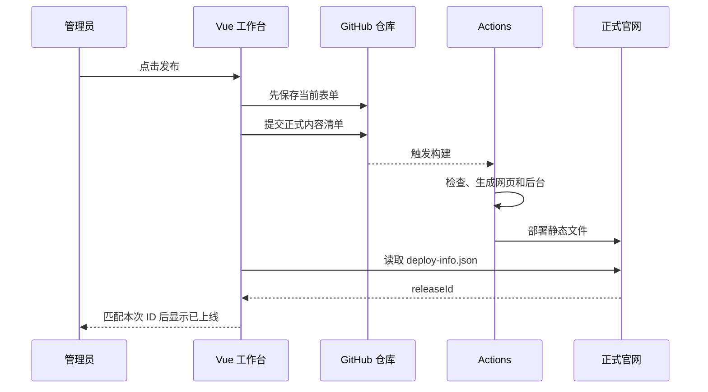

# 从零看懂 boss_ke：项目代码解析

这份手册只讲当前清理后的版本：**静态游戏官网 + Vue 3 内容编辑器 + GitHub 保存与部署**。本项目已经移除了早期本地用户名密码后台，不再要求你同时理解两套架构。

建议把 IDEA 分成两栏：左边看本文，右边打开提到的源码。代码里看不懂的符号，到 [语法详解](SYNTAX.md) 找对应解释；不知道一个文件是谁创建的，到 [文件来源索引](FILE_MAP.md) 查。

## 1. 先不用懂代码：网站到底做了什么

你有两种身份：玩家和管理员。

玩家打开官网，浏览器取得已经生成好的 HTML、CSS、JavaScript 和图片。JavaScript 在玩家电脑里运行，让图片轮播、复制提取码。

管理员打开工作台，使用发布密钥登录。表单把介绍、图片、下载设置整理成 JSON 内容，保存到 GitHub。发布时更新正式内容清单，GitHub Actions 生成新网页，再交给 GitHub Pages 提供给玩家。


**管理员改的通常是内容，不是 Vue 源码。** 游戏名变了，会重新生成包含新名字的 HTML，而不是自动重写 AdminView.vue。

## 2. 先认识六个名词

| 名词 | 用人话理解 | 在项目中做什么 |
| --- | --- | --- |
| HTML | 网页内容和结构 | 哪段是标题、图片、按钮 |
| CSS | 网页外观规则 | 颜色、大小、排版、手机布局 |
| JavaScript | 让程序按步骤执行的语言 | 点击、轮播、读取和保存内容 |
| Vue 3 | 用 JavaScript 管理复杂界面的工具 | 让后台输入框、列表、弹窗跟数据变化 |
| Node.js | 在浏览器外运行 JavaScript 的环境 | 在开发电脑和 Actions 中生成文件 |
| Vite | 处理 Vue 等源码的构建工具 | 把浏览器不能直接读取的 .vue 转成 JS/CSS |

GitHub 保存源码和内容；GitHub Pages 托管生成后的网页；GitHub Actions 自动执行检查与构建命令。三者有关联，但负责不同的工作。

当前电脑上的 Node.js 主要用于构建和本地预览。线上不需要一直运行你自己写的账号服务器。

## 3. “默认文件”先这样理解

`package.json` 是 npm 认识的文件名；`vite.config.js` 是 Vite 常用配置名；`src/main.js`、`App.vue` 是 Vue 项目常见的入口组织。

**名字常见，不等于里面是不能改的默认代码。** 本项目这些文件的内容已经按业务编写或修改。`src/github/client.js`、`src/site/render.js` 等则是本项目组织业务时自己设计的文件名。

真正自动生成的例子包括 npm 安装的 `node_modules/`、构建得到的 `pages-output/`、npm 更新的 `package-lock.json`。完整分类与每个文件的用途见 [FILE_MAP](FILE_MAP.md)。

## 4. 先看目录，不急着看每一行

```text
src/
  content/      游戏内容长什么样、允许填什么
  views/        后台页面：登录、编辑、预览
  lib/          页面共用的小工具
  github/       保存内容、调用 GitHub、创建提交
  site/         生成正式官网、轮播、官网样式
  components/   共用图标
scripts/        构建和本地预览启动
site-content/   管理员真正保存的内容和图片
public/         内置插画与图标
tests/          用假仓库验证功能的程序
docs/           学习资料
.github/        自动部署配置
```

阅读顺序推荐：**内容对象 → 官网模板 → 轮播 → Vue 表单 → 保存 → GitHub 提交 → 构建部署**。

## 5. 游戏内容其实是一个对象

打开 `src/content/default-content.js`。它用一个函数返回示例内容：

```js
export function defaultContent() {
  return {
    brand: { name: '雾海来信' },
    hero: { title: '首页标题', slides: [] },
    about: { body: '游戏介绍' },
    download: { enabled: true, url: '' },
  };
}
```

这是为说明结构而简化的片段，真实文件包含更多必需字段。不要用这段残缺示例覆盖正式 JSON。

`brand`、`hero`、`about`、`download` 是四个分组。`content.brand.name` 表示“取 content 里的 brand，再取 brand 里的 name”。

| 分组 | 内容 |
| --- | --- |
| brand | 游戏名称、英文名、工作室、联系方式 |
| hero | 大图上方小字、标题、副标题、轮播间隔、图片数组 |
| about | 介绍标题、正文、特点数组 |
| download | 开关、标题、说明、按钮文字、下载地址、版本、平台、大小、提取码 |

这个文件是我们自定义的样例数据工厂，测试会使用它。它不是“默认管理员账号”，也不会覆盖仓库里已经保存的游戏内容。

## 6. 正式内容存在另一个地方

`site-content/state.json` 保存当前草稿、图片记录、正式快照和历史。`site-content/published.json` 保存正式发布清单，应该与 state.published 一致。

```js
{
  revision: 2,
  content: { /* 草稿 */ },
  published: { id: '某次发布ID', content: { /* 正式内容 */ } },
  uploads: [ /* 素材记录 */ ],
  history: [ /* 最近发布历史 */ ]
}
```

上面是结构说明，不是完整可保存的 JSON。真正 JSON 不能写注释，属性名必须用双引号。

图片实际文件在 `site-content/uploads/`。图片记录包含 id、src、name、bytes、createdAt 等信息；页面通过这些记录显示素材库。

不要把示例文件和正式数据混为一谈：`default-content.js` 用来创建例子，`site-content/` 才是当前网站保存的内容。

## 7. 先理解“数据变成 HTML”

打开 `src/site/render.js`。最重要的是三个函数：

| 函数 | 输入 | 输出 |
| --- | --- | --- |
| renderDownload | 游戏内容 | 下载区 HTML；关闭时为空字符串 |
| renderSite | 游戏内容和显示选项 | 官网主体 HTML |
| renderDocument | 游戏内容和资源选项 | 完整 HTML 文档 |

例如：

```js
const title = '我的游戏';
const html = `<h1>${title}</h1>`;
```

结果是一段文字 `<h1>我的游戏</h1>`。把它作为 HTML 文件提供给浏览器，浏览器就知道要显示一个一级标题。

真实代码使用 `escapeHtml()` 处理文案，避免用户输入的 `<`、引号等被误当成标签或属性。`lines()` 把文字换行转换成 `<br>`。

## 8. 为什么官网不需要 Vue 才能显示

`renderDocument()` 直接返回一个已经包含标题、介绍、图片等内容的 HTML 字符串。构建脚本把它写入 `pages-output/index.html`。

玩家拿到这份文件就能显示主要内容，不需要等待后台登录、不需要请求内容数据库。Vue 用于管理员的复杂编辑界面；公开页面使用生成后的 HTML 和简单的轮播脚本。

根目录 `index.html` 是 Vue 后台的启动外壳；生成目录中的 `pages-output/index.html` 是正式官网。二者同名但来源、用途不同。

## 9. 下载按钮为什么有时不显示新文案

看 `renderDownload()` 的顺序：

1. `download.enabled=false`，返回空字符串，不显示下载区。
2. 开关为 true，检查 URL 是否以 HTTPS 开始。
3. 有地址，生成可点击的 `<a>`，使用 `download.buttonText`。
4. 无地址，生成禁用的 `<button>`，固定显示“下载即将开放”。

因此只改按钮文字、没填写地址时，页面仍显示固定提示。版本、平台、大小都是人工填写的展示数据，程序不会自动下载游戏包计算它们。

安装包保存在你选择的外部平台。本项目不存放游戏包，也没有绕过网盘的下载服务。

## 10. 轮播怎样从 HTML 里动起来

`renderSite()` 给元素加上 `data-slide`、`data-goto`、`data-next` 等标记。`src/site/runtime.js` 的 `mountSite()` 按这些标记找到图片和按钮。

```js
const slides = [...root.querySelectorAll('[data-slide]')];
let current = 0;
```

`slides` 是图片元素的列表，`current` 是当前下标。数组下标从 0 开始，所以第一张是 0。

`go()` 切换 `is-active` 类名，CSS 根据类名决定哪张可见；`start()` 运行计时器，每隔设定的毫秒数切下一张。

鼠标悬停、键盘焦点停在轮播内、手动暂停或页面隐藏时，自动切换会暂停。`mountSite()` 返回清理函数，用于移除事件和计时器。

## 11. 两份 CSS 分别管哪里

| 文件 | 管理范围 | 先搜索这些类名 |
| --- | --- | --- |
| `src/site/site.css` | 玩家看到的官网 | gs-hero、gs-about、gs-download |
| `src/styles.css` | 管理员登录、工作台、弹窗、预览容器 | login-page、workspace、panel、modal |

改后台按钮的颜色，不等于改官网按钮。长边大图使用 cover 铺满时可能裁边，这属于 CSS 显示方式，不表示上传图被截掉。

所有源码已展开排版。更详细的选择器、盒模型、Flex、Grid、定位和响应式讲解在 [语法详解](SYNTAX.md)。

## 12. 后台从哪里开始运行

后台的 `index.html` 提供 `<div id="app">` 容器，加载 `src/main.js`。

main.js 做四件事：创建 Vue 应用、配置 Router、检查受保护页面是否已登录、把根组件挂到 app 容器。

`App.vue` 提供 RouterView 和全局消息提示。真正的页面有：

- LoginView.vue：输入发布密钥。
- AdminView.vue：内容编辑、素材、历史和发布。
- PreviewView.vue：完整显示已保存的草稿。

动态 import 表示进到对应页面时再加载它。`#/admin` 一类地址由浏览器内部 Router 处理，GitHub Pages 不需要为每条后台路由运行服务器程序。

## 13. 登录时到底验证什么

```text
LoginView.submit
 → request('/api/auth/login', token)
 → github/client.handle
 → 创建 GitHubRepository
 → read 读取目标仓库
 → 成功后保留密钥并进入工作台
```

`src/lib/api.js` 中的 request 是我们写的统一操作入口。它把操作交给 `src/github/client.js`。这里的 `/api/auth/login` 是操作名称，不代表 Pages 上存在一个自己写的同名 HTTP 后端。

实际网络请求由 `repository.js` 发往 api.github.com。登录阶段能读到仓库，不保证密钥拥有写权限；保存和发布仍由 GitHub 检查写权限。

密钥暂存在当前标签页的 sessionStorage。退出清除本标签页保存的密钥；如果需要彻底使密钥失效，仍需到 GitHub 设置撤销。

## 14. 认识 Vue 的“数据驱动界面”

在 AdminView.vue 中找到：

```js
const form = ref(null);
```

ref 创建一个 Vue 能跟踪变化的值。JavaScript 中通过 form.value 读写，模板里可以直接用 form。

```vue
<input v-model="form.brand.name" />
```

输入框和游戏名称绑定：你输入的文字改变 form.brand.name，依赖它的页面也会更新。**这一步还没有保存到 GitHub。**

computed 计算“是否还有未保存内容”等结果；watch 监听表单变化，约 220 毫秒后生成右侧预览；onMounted 在页面出现后加载内容；onUnmounted 在离开时清理计时器。

## 15. AdminView.vue 的变量地图

| 变量 | 人话解释 |
| --- | --- |
| tabs / tab / currentTab | 全部标签页、当前选项、当前标题信息 |
| form | 你正在编辑的内容 |
| saved | 上次保存结果的字符串，用于比较改动 |
| meta | 草稿版本、正式版本、发布时间、发布 ID |
| uploads / history | 素材列表 / 发布历史 |
| loading / loadError | 读取中 / 读取失败原因 |
| busy / uploadBusy | 正在执行保存等操作 / 正在处理图片 |
| picker | 素材选择器状态：null 关闭，-1 新增，0 以上替换对应轮播项 |
| previewHtml | 右侧预览的完整 HTML |
| online | 这次发布是否真的出现在正式官网 |

不要先背所有变量。阅读一个按钮时，只看这个按钮涉及的那几个变量。

## 16. 三个状态，解决你之前的困惑

| 名称 | 它在比较什么 | 表示什么 |
| --- | --- | --- |
| unsaved | 当前表单与上次保存结果 | 有未保存的输入 |
| meta.dirty | 已保存草稿与正式内容 | 草稿还没发布 |
| online | 官网发布 ID 与本次发布 ID | 本次版本是否已经部署 |

输入后预览变化；保存后草稿变化；发布后正式清单变化；Actions 完成后官网才更新。这些不是同一步。

实时预览与“查看生成的 HTML”使用当前表单；完整预览使用已保存草稿；ZIP 使用已发布内容。看到不同版本时，先确认自己在看哪一份数据。

## 17. 一次“保存草稿”的完整路线

从模板里的 `@click="save"` 开始：

```text
save
 → persist：有未保存修改才继续
 → request：操作名称、方法、数据
 → githubRequest：写操作排队
 → handle：分发到保存分支
 → mutation('save')
 → repository.read：读取最新仓库快照
 → changeState：验证并得到下一版状态
 → repository.commit：创建 Git 提交
 → asDraft：组织返回数据
 → acceptDraft：更新表单和保存基准
```

`acceptDraft()` 把内容深复制给 form，保存 meta，并把 form 转成 JSON 字符串放进 saved。这样接下来输入时能判断“我是否改过它”。

`changeState()` 只转换数据，不发送网络请求。`repository.commit()` 才真正提交文件。把两种责任分开，测试就可以在不访问真实 GitHub 的情况下检查内容规则。

## 18. 为什么不能删除 expectedRevision

假设两个窗口都在第 4 版草稿上编辑。A 先保存，当前版本变成 5；B 仍带第 4 版提交。程序拒绝 B，避免旧内容覆盖 A。

`expectedRevision` 的意思是“我以为当前还是这个版本”。`changeState()` 检查它是否等于仓库版本。

这与 Git commit SHA 不是同一个概念：revision 是内容草稿版本，SHA 是仓库提交标识。上传素材也会有新 Git 提交，但不一定增加草稿 revision。

## 19. 一次“发布官网”比保存多做了什么

AdminView.publish() 先调用 persist，确保当前表单已保存；再以最新 revision 执行 publish。

在线操作层同时更新 state.json 和 published.json。仅保存草稿的提交被工作流忽略，改变正式清单的提交会触发构建。



`checkDeployment()` 约每 15 秒检查一次。有时候首页正常返回 200，但仍是旧版本；因此程序比较 releaseId，不能只检查页面能否打开。

## 20. GitHubRepository 的作用

把这个类理解成“只负责和目标仓库打交道的对象”。

| 方法 | 作用 |
| --- | --- |
| constructor | 保存仓库、分支、密钥、请求函数 |
| api | 给请求加授权、设置超时、翻译 GitHub 错误 |
| read | 读取分支头、提交和状态，得到一致快照 |
| bytes | 获取图片等文件字节 |
| commit | 准备文件树，创建提交，最后更新分支 |

Git 的 blob 是文件内容，tree 是路径与内容的集合，commit 关联一棵 tree 和父提交，ref 是分支指向哪里。

提交时先准备新对象，再创建 commit，最后用 force:false 更新 main。如果别人中途更新了分支，这次非强制更新会拒绝覆盖。浏览器里的写队列只管当前窗口，分支检查才应对别的窗口和电脑。

初学时先知道它实现“提交一组文件”，掌握表单和保存流程后再学习底层对象。

## 21. 图片从选择到官网经历什么

`prepareImage()` 检查原图类型、20MB 大小和像素数；用 Canvas 缩小到长边不超过 2400 像素；输出 WebP；检查结果不超过 3MB；最后转 Base64。

操作层再次检查编码、大小和文件头，生成 UUID 名称，提交图片与素材记录。

| 地址 | 用在什么阶段 |
| --- | --- |
| `/uploads/某UUID.webp` | 内容里的逻辑引用 |
| `site-content/uploads/某UUID.webp` | 仓库中真正的文件 |
| `blob:...` / `data:...` | 管理员当前浏览器预览 |
| `./assets/某UUID.webp` | 正式官网的静态图片 |

`imageRepositoryPath()` 转换仓库路径；hosting.js 的 imageUrl() 选择编辑器能显示的地址；构建脚本把正式图片复制到 assets。

只上传素材不会自动替换第一张。选择“添加”会往 hero.slides 末尾 push，选择“更换”只改一项 src，上移下移交换数组顺序。

## 22. 为什么有独立的验证函数

`src/content/validation.js` 检查输入结构、文字长度、图片路径、轮播数量、HTTPS 地址，再返回允许保存的字段。

输入框上的 maxlength 只是界面限制；真正的数据操作也需要检查。新增字段时必须检查验证函数是否把字段返回，否则会出现“能输入，保存后却消失”。

当前图片 1–8 张，间隔 3000–15000 毫秒，特点最多 6 项，正文最多 6000 字符。图片文件头检查不是完整的文件安全扫描。

## 23. 什么时候运行哪些代码

| 时间 | 执行者 | 代码 |
| --- | --- | --- |
| 运行 npm run build | 本机 Node.js | build-pages.mjs |
| 管理员打开后台 | 管理员浏览器 | main、Vue 页面、lib、github |
| 点击保存 | 浏览器和 GitHub API | client、state、repository |
| 正式发布触发构建 | Actions 的 Node.js | 测试、build-pages、Vite |
| 玩家打开官网 | Pages 提供文件，玩家浏览器执行 | 生成的 HTML/CSS、site.js |

同一个 JavaScript 语言可以在不同环境执行。普通浏览器不能直接使用 node:fs 写你服务器的文件，Node.js 也没有普通浏览器页面的 document 对象。

## 24. 构建到底生成了哪些文件

```text
pages-output/
  index.html          正式官网
  site.css / site.js  官网样式与轮播脚本
  favicon.svg
  assets/             正式内容使用的图片
  deploy-info.json    本次发布 ID、草稿版本、提交、构建时间
  .nojekyll
  admin/
    index.html        Vue 后台外壳
    app-assets/       Vue 构建产物
    sample-art/       内置插画
    site-assets/      预览用官网样式和脚本
```

`scripts/build-pages.mjs` 先检查正式清单一致，再生成官网和图片，最后调用 Vite 构建后台。Vite 的插件、相对资源路径和后台输出目录在 vite.config.js 配置。

本地 npm run build 只生成文件，不自动上传。源码推到 main 或后台正式发布后，Actions 会在云端再构建部署。

## 25. 本地启动为什么也需要 Node.js

start.bat 是 Windows 入口，检查能否找到 node，再运行 scripts/start.mjs。

start.mjs 检查版本与依赖、构建页面、调用 Vite 的静态预览服务，并打开后台。它不再创建账号数据库，不再维护本地密码。

当前 npm run dev 是“构建后预览”，没有热更新；修改源码后重新运行即可。npm start 仅预览已有生成目录，不会自动重新构建。

本地后台输入真实密钥后，仍操作真实 GitHub 仓库；本地地址不等于隔离沙盒。学习时用配套练习和模拟测试。

## 26. 错误在哪里出现

| 现象 | 阅读入口 |
| --- | --- |
| 入口脚本没加载 | 根 index.html 的启动提示 |
| 页面模块加载失败 | main.js 的 router.onError |
| 没有权限、密钥过期 | repository.api 的 GitHub 状态处理 |
| 草稿版本冲突 | state.changeState 的 expectedRevision |
| 图片不允许删除 | state 的引用检查 |
| 字段不合法 | content/validation |
| 点击按钮后显示错误 | AdminView 的 try/catch 和 notify |
| 保存了但官网没变 | unsaved、dirty、online 与 Actions |

不要看到一个错误就同时改很多文件。先确定失败发生在输入、保存、提交、构建还是浏览器显示这一层。

## 27. 测试怎样在不碰真实仓库的情况下工作

`tests/helpers/github-fixture.mjs` 用内存 Map 模拟文件树、提交和分支，提供 fetcher。测试创建 GitHubRepository 时传入这个 fetcher，因此请求交给模拟器，不发给真实 GitHub。

内容测试验证输入规则和 HTML；仓库测试验证错误与编码；GitHub 流程测试验证草稿隔离和冲突；浏览器测试实际点击页面并拦截 API，完成一遍完整流程。

模拟通过只证明模拟条件下行为正确。真实部署还要看 Actions 和正式 deploy-info，因此保留多个层次的验证。

## 28. 你以后修改功能时怎么找文件

| 想改什么 | 首先看哪里 |
| --- | --- |
| 游戏介绍、图片顺序、下载信息 | 现有后台表单 |
| 官网颜色、字号、布局 | site/site.css、site/render.js |
| 后台界面和字段 | views/AdminView.vue、styles.css |
| 内容允许范围 | content/validation.js，连同表单限制 |
| GitHub 保存规则 | github/state.js、client.js、repository.js |
| 构建目录、部署步骤 | scripts/build-pages、vite.config、pages.yml |

新增一个字段时，完整路线是：样例/旧数据兼容 → 内容验证 → 表单 → 模板渲染 → 测试 → 构建部署。只改其中一处通常不够。

## 29. 用这个顺序学，不要一次啃完

| 轮次 | 阅读与练习 | 完成目标 |
| --- | --- | --- |
| 第一轮 | SYNTAX 前半：变量、对象、函数、HTML/CSS | 能读懂内容对象和一小段页面 |
| 第二轮 | default-content、render、runtime | 能解释一张图和一个按钮如何出现 |
| 第三轮 | Vue 语法、LoginView、AdminView 的 form/persist | 能解释输入、预览和保存 |
| 第四轮 | client、state、repository | 能从按钮追到 GitHub 提交 |
| 第五轮 | build-pages、工作流、测试 | 能区分提交成功与官网上线 |

源码中遇到短表达式，先拆成变量和 if 语句在笔记里理解；不要为了看懂就删掉验证和并发保护。更多逐文件职责、函数行号和参考答案见配套资料。
